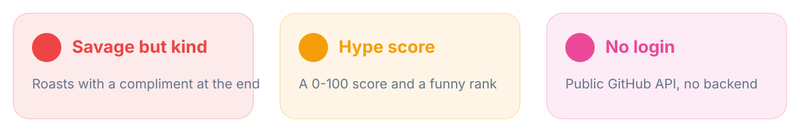

<div align="center">


<br>


### یوزرنیم گیتهابت رو بذار، کبابت کنیم! 🔥

</div>

---

<div dir="rtl">

## 😈 این چیه؟

یه یوزرنیم گیتهاب می‌نویسی، این ابزار ریپوهاش رو نگاه می‌کنه و با یه مشت جمله‌ی شوخ و فارسی رستش می‌کنه — و آخرش هم یه تشویق می‌کنه تا دلش نشکنه. 😄

بدون لاگین، بدون بک‌اند، بدون نصب. فقط یه فایل HTML که مستقیم از API عمومی گیتهاب داده می‌گیره.



## 🧪 چطور کار می‌کنه؟

ریپوهای عمومی یه آدم رو می‌خونه و چیزایی مثل اینا رو می‌سنجه:

| معیار | چرا مهمه؟ |
|---|---|
| ⭐ جمع استارها | محبوبیت |
| 👥 فالوئر به فالوئینگ | نسبت شهرت به فان‌بویی |
| 📝 ریپوهای بدون توضیح | نظم و انضباط |
| 🍴 نسبت فورک به ریپوی اصلی | کپی‌کاری یا ابداع؟ |
| 🕸️ آخرین پوش | زنده بودن پروفایل |
| 💻 زبان پرکاربرد | جمله‌ی مخصوص همون زبان |
| 🎭 اسم‌های تنبلی مثل `test` و `untitled` | بدون شرح |

بعد هم یه **امتیاز ۰ تا ۱۰۰** و یه رتبه‌ی بامزه می‌ده. از «تازه‌کارِ با پتانسیل» تا «اسطوره‌ی سیاره‌ی گیتهاب» 👑

## 🚀 اجرا

### محلی

```bash
git clone https://github.com/CyberLoop-dev/ghroast.git
cd ghroast
# index.html رو باز کن و یه یوزرنیم بنویس
```

### آنلاین (رایگان با GitHub Pages)

1. برو `Settings` ← `Pages`
2. برنچ `main` و پوشه‌ی `/ (root)` رو انتخاب کن
3. بعد از یه دقیقه سایت آنلاینه:

```text
https://CyberLoop-dev.github.io/ghroast/
```

لینک مستقیم هم داره! کافیه به آخر آدرس `?u=username` اضافه کنی:

```text
https://CyberLoop-dev.github.io/ghroast/?u=torvalds
```

## 🤝 جمله اضافه کن

توی `index.html` تابع `analyze` رو باز کن؛ هر جمله یه شرط ساده داره:

```js
if (stars === 0 && n > 3) pool.push('۴ تا ریپو و صفر استار؟ 🥲');
```

جمله‌هات رو با PR بفرست. فقط دقت کن شوخی باشه، نه توهین. 😉

## ❓ سوالات پرتکرار

**می‌شه روی ریپوهای خصوصی هم اجرا شه؟**
نه، فقط اطلاعات عمومی خونده می‌شه.

**گفت «محدودیت درخواست»؟**
API بدون لاگین گیتهاب سقف ساعتی داره. یه ساعت بعد دوباره امتحان کن.

**امتیاز جدیه؟**
اصلا! امتیاز توضیحش فقط سرگرمیه و هیچ‌ربطی به کیفیت کدت نداره. کسی توی دنیا با یه عدد ازش قضاوت نمی‌شه. 🤗

## 🗺️ نقشه‌ی راه

- [ ] حالت «مهربون» و «خیلی تند»
- [ ] کارت اشتراک به شکل تصویر
- [ ] مقایسه‌ی دو یوزر با هم (بازی دونفره 🥊)

## 💜 حمایت

اگه خندیدی، یه ⭐ بده و لینکش رو برای رفیقات بفرست تا اونا هم رست بشن!

License: [MIT](LICENSE)

</div>
